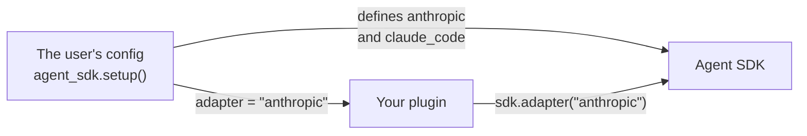

Your plugin never chooses an adapter. Your users set up their adapters once, in Agent SDK, then tell your plugin which one to use by name.



First, the user sets up their adapters in their own config:

```lua
require("agent_sdk").setup({
  adapters = {
    anthropic = {
      base = "anthropic",
      env = {
        api_key = "cmd:op read op://Private/Anthropic_API/credential --no-newline",
      },
    },
    claude_code = {
      base = "acp",
      commands = { default = { "claude-agent-acp" } },
    },
  },
})
```

Then, in the same config, they set up your plugin and name the adapter it should use:

```lua
-- The user picks their anthropic adapter for your plugin
require("your_plugin").setup({ adapter = "anthropic" })
```

Your plugin takes that name and [resolves it](/walkthroughs/chat-plugin) with `sdk.adapter()`. Another plugin can use the user's `claude_code` adapter at the same time.

The key is the user's name for the adapter. `base` names the built-in adapter it starts from, and the rest of the table overrides any part of it. A string, like `anthropic = "anthropic"`, uses a built-in adapter as it ships.

A plugin never adds an adapter itself. A user adds a third-party adapter in their own setup:

```lua
require("agent_sdk").setup({
  adapters = {
    vertex = require("vertex-adapter"),
  },
})
```

A third-party adapter is a table like any other, so it can set `base` too, and build on `openai` for example.

## Built-in adapters

Agent SDK ships one adapter per API format. Any other provider, or any ACP agent, extends one of them.

| Name | Type | Talks to |
| --- | --- | --- |
| `acp` | ACP | Any ACP agent, such as Claude Code |
| `anthropic` | HTTP | Anthropic's Messages API |
| `openai` | HTTP | OpenAI's Chat Completions API |

See [Providers and agents](/configure/providers) for a setup to copy for each.

## Parameters

`parameters` sets the model, how hard it thinks, and anything else the adapter sends. The same keys work for HTTP adapters and ACP agents:

```lua
anthropic = {
  base = "anthropic",
  parameters = { model = "claude-opus-5-5", thought_level = "high" },
},
```

See [Adapters](/reference/adapters#parameters) in the reference for what each key becomes on each adapter.

## Extending an adapter

A provider that speaks a built-in adapter's format extends that adapter. Most only need a URL, a key and their models:

```lua
require("agent_sdk").setup({
  adapters = {
    deepseek = {
      base = "openai",
      url = "https://api.deepseek.com/chat/completions",
      env = { api_key = "DEEPSEEK_API_KEY" },
      parameters = { model = "deepseek-v4-flash" },
      models = {
        ["deepseek-v4-flash"] = {},
        ["deepseek-v4-pro"] = { opts = { can_reason = true } },
      },
    },
  },
})
```

Your table is merged into a copy of the `base` adapter. `models` is the exception: yours replaces the adapter's, so DeepSeek doesn't list OpenAI's models.

### Models

`parameters.model` is the model a session uses unless the plugin picks another. `models` lists the models the adapter knows, keyed by the provider's model ID:

| Field | |
| --- | --- |
| `formatted_name` | The name to show, like `"Opus 5.5"` |
| `meta.context_window` | The most tokens the model can read |
| `meta.max_tokens` | The most tokens the model can write in a reply |
| `opts.can_reason` | The model can reason, so the adapter sends thinking or reasoning settings |
| `opts.has_vision` | The model accepts images |

Every field is optional, so `["deepseek-v4-flash"] = {}` is enough. A plugin can still pick a model that isn't listed. The adapter then treats it as unable to reason and without vision.

### Overriding a handler

Handlers turn the session's messages into the provider's request, and its response into text, reasoning and tool calls. Override one when a provider's format differs from the base. Require the base adapter to call its own handler from yours:

```lua
local openai = require("agent_sdk.adapters.http.openai")

require("agent_sdk").setup({
  adapters = {
    openrouter = {
      base = "openai",
      url = "https://openrouter.ai/api/v1/chat/completions",
      env = { api_key = "OPENROUTER_API_KEY" },
      handlers = {
        request = {
          build_parameters = function(self, args)
            local params = openai.handlers.request.build_parameters(self, args)
            params.provider = { sort = "throughput" }
            return params
          end,
        },
      },
    },
  },
})
```

`openai`'s `parse_chat` keeps any field outside OpenAI's spec in `extra`. A `parse_meta` handler reads it, for example to show DeepSeek's `reasoning_content` as reasoning:

```lua
handlers = {
  response = {
    parse_meta = function(self, args)
      local reasoning = args.data.extra.reasoning_content
      if reasoning then
        args.data.output.reasoning = { content = reasoning }
      end
      return args.data
    end,
  },
},
```

| Handler | Runs | Returns |
| --- | --- | --- |
| `lifecycle.setup` | Before each request | `false` to stop the request |
| `request.build_parameters` | Building the body | The request's parameters |
| `request.build_messages` | Building the body | `{ messages = ... }`, plus any other body fields |
| `request.build_tools` | Building the body, when the session has tools | `{ tools = ... }`, in the provider's format |
| `request.build_body` | Building the body | Extra body fields |
| `response.parse_tokens` | For each chunk | The total token count, or `nil` |
| `response.parse_chat` | For each chunk | `{ status = "success", output = { content, reasoning } }`. Adds tool calls to `args.tools` |
| `response.parse_meta` | After `parse_chat`, when it returned `extra` | The same table, changed |
| `tools.format_calls` | When the reply ends | The tool calls, as `{ id, function = { name, arguments } }` |
| `request.build_reasoning` | When the reply ends | The reasoning to send back next turn |
| `lifecycle.on_exit` | When the request ends | Nothing |

## Credentials

`env` holds the values an adapter needs, like an API key. Each value can be an environment variable's name, a `cmd:` for a password manager, a `file:`, a function, or the key itself:

```lua
env = { api_key = "cmd:op read op://Private/Anthropic_API/credential --no-newline" },
```

See [Credentials](/reference/credentials) for every form, when they're read, and how the SDK keeps them out of logs and command lines.

## Choosing a model in a plugin

Your plugin's `adapter` option can also take a table, so the user can pick a model for your plugin alone:

```lua
-- The user picks their anthropic adapter, with a model other than its default
require("your_plugin").setup({
  adapter = { name = "anthropic", model = "claude-opus-5-5" },
})
```

The `model` replaces the adapter's default model for your plugin's sessions. The user's adapter config stays as they set it.
