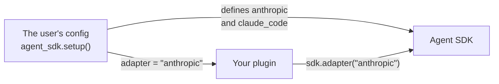

Your plugin never chooses an adapter. Your users set up their adapters once, in Agent SDK, then tell your plugin which one to use by name.



First, the user sets up their adapters in their own config:

```lua
require("agent_sdk").setup({
  adapters = {
    anthropic = require("agent_sdk.adapters").extend("anthropic", {
      env = {
        api_key = "cmd:op read op://Private/Anthropic_API/credential --no-newline",
      },
    }),
    claude_code = "claude_code",
  },
})
```

Then, in the same config, they set up your plugin and name the adapter it should use:

```lua
-- The user picks their anthropic adapter for your plugin
require("your_plugin").setup({ adapter = "anthropic" })
```

Your plugin takes that name and [resolves it](/walkthroughs/chat-plugin) with `sdk.adapter()`. Another plugin can use the user's `claude_code` adapter at the same time.

The key is the user's name for the adapter. A string uses a built-in adapter as it ships. `extend()` copies a built-in adapter and overrides any part of it.

A plugin never adds an adapter itself. A user adds a third-party adapter in their own setup:

```lua
require("agent_sdk").setup({
  adapters = {
    vertex = require("vertex-adapter"),
  },
})
```

## Built-in adapters

Agent SDK ships one adapter per API format. Any other provider extends one of them.

| Name | Type | Talks to |
| --- | --- | --- |
| `anthropic` | HTTP | [Anthropic's Messages API](/configure/anthropic) |
| `claude_code` | ACP | [Claude Code](/configure/claude-code), through [claude-agent-acp](https://github.com/agentclientprotocol/claude-agent-acp) |

## Credentials

`env` holds the values an adapter needs, like an API key. Each value is one of:

| Value | Resolves to |
| --- | --- |
| `"ANTHROPIC_API_KEY"` | That environment variable. If it isn't set, the string itself |
| `"cmd:op read op://..."` | The command's output, with trailing whitespace removed |
| `"file:~/.secrets/anthropic"` | The file's contents |
| `function(adapter) ... end` | What the function returns |

A `cmd:` runs once and its output is reused, so the password manager asks once. It runs again after an HTTP provider rejects the key with a 401 or 403.

A failing `cmd:` ends the prompt in an error with its stderr:

```text
agent-sdk.nvim: the command `op read op://Private/Anthropic_API/credential` failed: [ERROR] not signed in
```

## Choosing a model in a plugin

Your plugin's `adapter` option can also take a table, so the user can pick a model for your plugin alone:

```lua
-- The user picks their anthropic adapter, with a model other than its default
require("your_plugin").setup({
  adapter = { name = "anthropic", model = "claude-opus-5-5" },
})
```

The `model` replaces the adapter's default model for your plugin's sessions. The user's adapter config stays as they set it.
